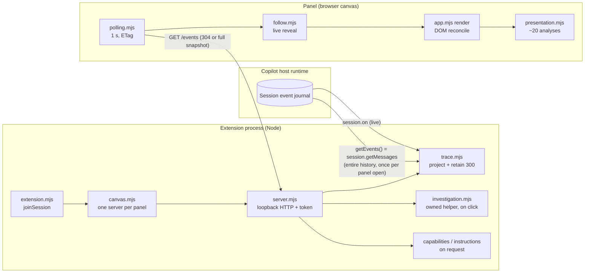
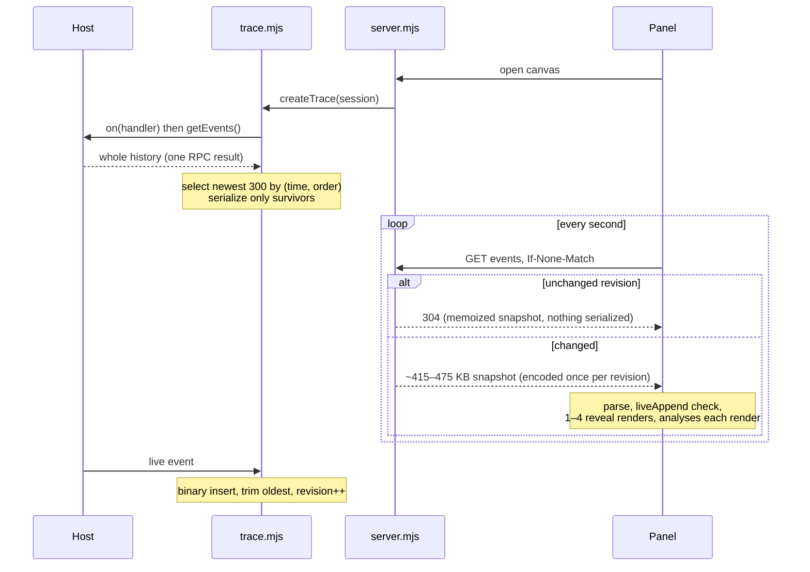

# Efficiency review

Owner-requested review of every Trace stage for heavy, continuous Copilot use (2026-11-21, version 0.1.54). Goal: remove every cost that buys no functionality, then measure what each remaining feature costs so the owner can decide what to keep. `test/scale.test.mjs` guards the results.

## Method

- **Workload.** `test/fixtures/workload.mjs` generates seeded host-shaped sessions: prompts, model turns, reasoning, tool requests with pre/post hooks, permission round trips, delegated subagents, skills, compactions, errors and live-only usage receipts. Tool results are 70% under 2 KB, 25% 2–40 KB and 5% 100 KB–1 MB, so 94,000 history events are about 443 MB. `anomalies` adds duplicate IDs, out-of-order/equal/missing/invalid timestamps, checkpoint copies, oversized IDs, unsupported types, orphaned boundaries and aborts; `tools` changes the tool mix (for example, every call a delegated `task`).
- **Numbers.** Every figure below comes from `npm run bench`; "before" is the same script run against the unmodified 0.1.53 modules. Windows 11, Node 24.22.1, runs one at a time. Absolute times vary by machine; ratios and growth rates are the stable signal.
- **Equivalence.** Each change was compared with the 0.1.53 modules on identical inputs: 1,047 full trace snapshot comparisons (entries, order, `omitted`, `revision`, live receipts, history state; live-before-history, failure, invalid payload, close and unsupported-API scenarios) and 6,912 presentation outputs (every analysis the panel uses, on 300- and 3,000-record windows, with the default, delegation-only and delegation-plus-shell mixes, anomalies and deliberately tampered evidence). All were identical. `test/scale.test.mjs` keeps an independent oracle of the original retention rule and fails on the 0.1.53 code.
- **Not measured.** Native panel layout and paint (UI automation is not authorized), work inside the host runtime for `session.getMessages`, and live model behavior.

## How Trace works

## Section review

| Stage | Runs | Before (0.1.53) | After (0.1.54) | What changed |
| --- | --- | --- | --- | --- |
| History hydration, `trace.mjs` | each panel open, whole chat | 94k events: **9,521 ms** (28k: 2,758; 9k: 893), event loop blocked | **44 ms** (28k: 16; 9k: 6) | Every event was serialized, then the whole window re-sorted with `Date.parse` in the comparator per insert. Now survivors are selected on cheap keys and only 300 are serialized. |
| Live ingestion | each host event | ~0.09 ms | ~0.01 ms | Binary insertion into a time-ordered window with cached times; trimming advances a head index. |
| Unchanged poll | 1/s per panel | 0.02 ms, snapshot rebuilt | <0.001 ms | Snapshot memoized per revision; each caller still gets its own arrays. |
| Changed poll | each revision | serialized per request | encoded once per revision | 415–475 KB at the 300 cap. |
| One render's analyses, 300 records | each render | 5.9 ms new snapshot · 5.7 ms repeat | **2.5 ms · 2.0 ms** | Every analysis re-parsed the same evidence JSON; now once per entry, revalidated if the entry changes. |
| All analyses, 3,000 records (cold) | scaling headroom | 140 ms | 80 ms | |
| All analyses, 30,000 records (cold) | scaling headroom | **6,413 ms** | **1,264 ms** | Five analyses were quadratic: `observedActivity` 1,955→144 ms, `recoveryAttempts` 1,762→138, `actionStages` 1,302→95, `agentLanes` 300→39, `delegationHandoffs` 237→72. |
| Client `liveAppend` check and parse | each changed poll | ~1 ms + ~0.5 ms | unchanged | Small at this cap (scratch measurement; not in `npm run bench`). |
| Investigation, capabilities, instruction sources, examples, replay | explicit click | bounded | unchanged | No timers or polling while idle; each has its own deadline and byte bounds. |
| Optional panels (recap, arguments, glossary, plausible actions, surprises) | each render | skipped while closed | unchanged | Already gated on being open. |
| Statistics drawer reports | each render | 2.3 ms, even when closed | 0.7 ms, even when closed | See decision 5. |

The five rewrites replace per-item rescans of every retained entry with a single index or a position sort. Each sort applies only to records already proven unique by ID, so recorded order is unchanged. `agentLanes` also counts overlapping lane pairs with a sweep line instead of comparing every pair of lanes. `observedRecap` only composes linear analyses; it was never quadratic. Nothing visible changed.

## What still scales with usage

The panel's steady-state cost is now bounded by the 300-event window, not by chat length, with one exception: **opening a panel still asks the host for the entire chat history.** Live ingestion, polling and rendering are constant per event or per second.

## Owner decisions

Each option below would trade a feature, an exactness guarantee or a design boundary for a further gain. None is implemented.

### 1. Read only the history tail instead of the whole chat (largest remaining win)

`session.getEvents()` is a single `session.getMessages` request that returns every event (`copilot-sdk/index.js`, installed build `1.0.106-8.unstable.r43566476370.g869eef3`). On the extension side alone, parsing that result for 94k events takes about **580–640 ms and retains about 604 MB of heap** while it is held (28k: ~150 ms / 178 MB; 9k: ~50 ms / 88 MB). Runtime-side reading and serialization are extra and unmeasured, and the whole request must finish inside the 10-second history deadline or the panel reports history unavailable. The installed experimental `session.rpc.eventLog.read({ direction: 'backward', max, types })` returns the newest persisted events first; a 400-event tail page (0.9–2.1 MB) parses in **about 1–3 ms regardless of chat length**.

What it costs:
- The exact older-event count. Trace shows "N older events omitted"; a tail read knows only that older events exist (`hasMore`). The display would become "older events omitted (count unknown)" unless a separate full scan is kept.
- Exactness for out-of-order timestamps: Trace orders by recorded time, but tail pages follow append order. Reading one extra page covers small skews; an arbitrarily old append with a newer timestamp could be missed.
- An experimental API dependency: it needs installed-runtime fixture coverage and a fallback to `getEvents()` when unsupported.

### 2. The 300-event window

At this cap everything above is cheap; for a 24/7 agent the window may cover only minutes of activity. With the quadratic analyses removed, the window is limited by payload and DOM size rather than analysis time. If raised, a new snapshot's analyses cost about 80 ms at 3,000 records and 1.3 s at 30,000 (cold), and each changed poll would carry roughly 10× or 100× today's ~450 KB. DOM reconciliation and layout for 3,000+ rows are unmeasured. Raising it adds capability at a cost, so the decision is the owner's; about 1,000 looks feasible without further design work, while larger windows would also need decisions 3 and 4.

### 3. Live reveal animation

While following live activity, each changed poll is revealed in up to four frames, and each frame is a full render: **2.66 renders per changed poll on average versus 1 without the stepped reveal**. Removing it (keeping instant scroll-to-bottom) cuts steady-state render work by about 60% during active sessions. The cost is the progressive "events slide in" behavior added in 0.1.51.

### 4. Full snapshot per revision

Every change re-sends the whole retained window (~450 KB), and the client re-parses it and re-checks every entry. A delta protocol ("entries since revision N") would cut transfer and parsing to the new events but adds protocol state, resynchronization paths and tests. Recommended only if the window grows well beyond 300.

### 5. Statistics drawer computed while closed

Retrieval, validation, observed-activity, repetition and summary reports run on every render even with the drawer closed: 0.7 of the 2.0 ms repeat render at 300 records, growing linearly with the window. Computing them only while the drawer is open is output-preserving in principle but changes when the drawer's DOM updates, so it needs owner UI acceptance.

### Kept as is

- Serializing each new event's full payload before clipping to 12,000 code units, which keeps the `truncated` and protected-content flags exact, now costs about 0.01 ms per live event.
- The 12,000-unit evidence cap and the one-second poll interval are cheap at current sizes and directly visible to the user.
